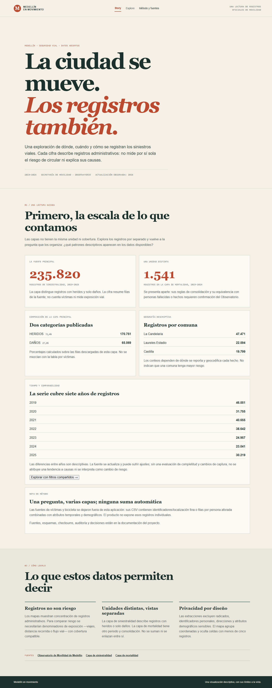
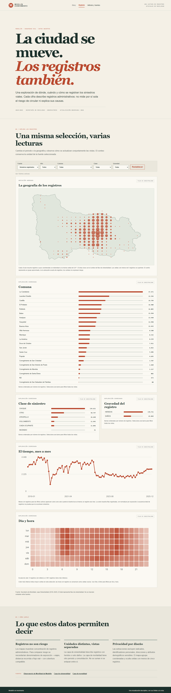

# Medellín en movimiento

## Exploración visual descriptiva de la siniestralidad vial registrada en Medellín

**Documento académico de proyecto**
Asignatura: Visualización y Data Storytelling
Instantánea analizada: 2 de noviembre de 2026
Versión del informe: 4 de noviembre de 2026
Equipo, curso, docente y horas de trabajo: **pendientes de completar por el equipo**

---

## Resumen

Medellín en movimiento es una aplicación web para explorar registros oficiales de siniestralidad vial en Medellín en dos modos complementarios. Story presenta una lectura guiada de los datos y sus límites; Explore permite filtrar una fuente y examinar seis vistas coordinadas: mapa agregado, barras por comuna, clase y gravedad, serie mensual y heatmap por día de semana y hora. Una vista separada permite cambiar a la capa de mortalidad sin unir sus registros con los de siniestralidad.

El diseño sigue las preguntas **What, Why y How** de Tamara Munzner: caracteriza las entidades, atributos, transformaciones y problemas de calidad; define tareas descriptivas que la interfaz realmente soporta; y conecta cada tarea con marcas, canales e interacciones concretas. Las cifras son conteos de filas adquiridas, no estimaciones de riesgo ni tasas de siniestralidad. La unidad de la capa de mortalidad no está confirmada como persona o evento, por lo que se mantiene la etiqueta “registros de la capa de mortalidad”.

La instantánea contiene 235.820 filas de siniestralidad entre enero de 2019 y diciembre de 2025. De ellas, 170.751 están etiquetadas HERIDOS y 65.069 DAÑOS. La comuna con más filas en esta instantánea es La Candelaria, con 47.471. Estos valores describen el contenido de la fuente y no permiten comparar riesgo entre lugares sin población expuesta, volumen de viajes u otro denominador pertinente.

**Palabras clave:** visualización de información, siniestralidad vial, Medellín, exploración coordinada, calidad de datos, privacidad.

## 1. Problema, propósito y alcance

Los registros administrativos contienen dimensiones espaciales, temporales y categóricas que pueden ser difíciles de recorrer en tablas. Una interfaz visual puede facilitar la localización de concentraciones registradas, la comparación de categorías y la exploración de ritmos temporales, siempre que haga explícitas la unidad, la cobertura y las limitaciones de la fuente.

El problema que aborda este proyecto es de exploración y comunicación: ¿cómo permitir a una audiencia no especializada recorrer la distribución de los registros publicados por la Secretaría de Movilidad y comprender qué se puede y qué no se puede inferir de ellos? El producto no estima la probabilidad de sufrir un siniestro, no identifica causas y no evalúa la seguridad vial relativa de las comunas.

La audiencia prevista incluye estudiantes, ciudadanía interesada en movilidad, periodistas de datos y personas que consultan información urbana. Story ofrece contexto y una secuencia de lectura; Explore ofrece controles de selección y comparación descriptiva. Método y fuentes documenta procedencia, definiciones y cautelas.

El alcance implementado se limita a dos capas oficiales separadas: siniestralidad (categorías publicadas HERIDOS y DAÑOS) y mortalidad. Los registros individuales de víctimas y de aforos de bicicleta no se cargan en la aplicación: sus diccionarios incluyen identificadores, direcciones o combinaciones de estación, tiempo y atributos que justifican no exponerlos en esta versión. No se combinan capas con unidades diferentes.

## 2. What — datos, unidades y transformaciones

### 2.1 Fuentes y unidades de análisis

| Fuente | Qué representa en este trabajo | Cobertura de la instantánea | Filas | Uso y cautela |
|---|---|---:|---:|---|
| Secretaría de Movilidad, capa ArcGIS de siniestralidad | Fila publicada en la capa de siniestralidad; la clasificación de gravedad observada incluye HERIDOS y DAÑOS | 2019-01 a 2025-12 | 235.820 | Fuente principal. No equivale a un conteo de personas lesionadas ni a una tasa de riesgo. |
| Secretaría de Movilidad, capa ArcGIS de mortalidad | Fila de la capa denominada mortalidad | 2019-01 a 2024-12 | 1.541 | Vista aparte. No se verificó que una fila equivalga a una persona fallecida o a un evento. |
| MEData, víctimas de incidentes viales | Víctima individual, según ficha/diccionario | Publicación desde 2014 | No descargada | Se consultó el diccionario; se excluyó el CSV individual por campos de expediente y dirección. |
| MEData, caracterización/uso de bicicleta | Persona ciclista observada en una estación de aforo | Metadato desde 2018 | No descargada | Se consultó el diccionario; no se mezcló con registros de siniestros por diferencia de unidad y riesgo de identificación combinatoria. |
| Alcaldía de Medellín, límite municipal | Geometría de referencia administrativa | Versión guardada en la adquisición | 1 geometría/capa | Contexto espacial y control de pertenencia; no es una variable de exposición. |

Los endpoints, fechas de consulta, campos solicitados, licencias indicadas, hashes y condiciones de uso se registran en `DATA_SOURCES.md` y `reports/acquisition_manifest.json`. La capa ArcGIS de siniestralidad no expuso una licencia abierta explícita en los metadatos revisados; las condiciones de redistribución deben confirmarse con el proveedor. Los diccionarios de MEData indican CC BY-SA 4.0 para sus fichas, pero esa licencia no convierte en apropiado publicar microdatos sensibles.

### 2.2 Modelo de datos (What)

A nivel de abstracción, cada fila analítica de siniestralidad tiene atributos temporales (fecha, hora, día, mes, año), nominales (clase, gravedad, comuna y barrio cuando están disponibles) y espaciales (coordenadas/geométrica de punto). La capa de mortalidad usa su propio esquema y campos: fecha, hora, clase, comuna y geometría cuando están presentes. Las categorías se conservan como fueron publicadas; las filas de ambas fuentes no se relacionan ni se suman.

Las variables derivadas para agregación incluyen año y mes calendarios, día de semana, hora entera y grupo espacial aproximado. La API devuelve conteos por fuente, categorías, meses, día-hora y celdas de coordenadas; no entrega al navegador los identificadores de registro ni los puntos individuales. El área de cada círculo del mapa representa conteos de filas. No se calcula una tasa, un denominador de exposición ni un indicador de riesgo.

### 2.3 Preparación y calidad observada

Las fechas de ambas capas se pudieron interpretar en la auditoría. En siniestralidad se observaron nulos en barrio (0,10%) y número de comuna (0,109%); 175 firmas repetidas en los atributos analíticos al excluir ObjectID. En mortalidad faltan geometría/coordenadas en 4 de 1.541 filas (0,26%) y clase en 9 (0,58%); se encontraron 33 firmas repetidas al excluir ObjectID. Una firma repetida no prueba por sí misma que dos filas sean duplicados erróneos, por lo que se conservaron.

En el control espacial se observaron 237 puntos de siniestralidad y 4 de mortalidad fuera del polígono municipal; además, 7 puntos de siniestralidad quedaron fuera de la envolvente rectangular auditada. No se eliminaron ni desplazaron. Las coordenadas disponibles se compararon con la geometría GeoJSON. La verificación del índice espacial se contrastó en 1.000 puntos contra recorrido completo, sin discrepancias.

Las decisiones de adquisición redujeron campos potencialmente identificables: en la capa de siniestralidad se excluyeron radicado y dirección; en mortalidad se excluyeron ID, direcciones, sexo y edad. Las capturas agregadas del mapa usan redondeo a 0,01 grados y omiten grupos con menos de cinco filas. Este redondeo no forma celdas de igual área ni constituye anonimización formal.

## 3. Why — objetivos, preguntas y tareas

El objetivo analítico es hacer inspeccionables patrones de **registros publicados** en las dimensiones disponibles. La visualización ayuda a buscar agrupaciones, identificar categorías y comparar conteos bajo filtros comunes. No decide qué lugar es más peligroso ni explica por qué cambia un conteo.

### Preguntas que la versión implementada permite explorar

1. ¿Dónde se agrupan espacialmente los registros seleccionados en el mapa municipal agregado?
2. ¿Cómo se distribuye el conteo de filas entre comunas?
3. ¿Qué clases y categorías de gravedad aparecen y cómo se comparan en número de filas?
4. ¿Cómo varía el número de filas por mes dentro de la cobertura observada?
5. ¿Cómo se distribuyen las filas por combinación de día de semana y hora?
6. ¿Cómo cambian esas vistas al seleccionar año, comuna, clase, gravedad o una marca visual?
7. ¿Qué diferencias descriptivas aparecen al consultar la capa de mortalidad por separado?

| Nivel de tarea | Tarea concreta | Soporte de interfaz | Interpretación permitida |
|---|---|---|---|
| Buscar / localizar | Encontrar agrupaciones en el espacio municipal | Mapa y filtro por selección de celda | Concentración de filas observadas en grupos aproximados. |
| Identificar | Reconocer valores de una comuna, categoría, mes o celda | Etiquetas, tooltip y controles | Nombre y conteo de la selección vigente. |
| Comparar | Contrastar conteos entre comunas o categorías | Barras horizontales ordenadas y cifra | Comparación de conteos brutos, no de tasas. |
| Resumir patrón | Leer secuencia mensual o ciclo día-hora | Serie mensual y heatmap | Descripción de la cobertura y frecuencia registrada. |
| Explorar | Cambiar filtros y coordinar las vistas | Fuente, año, comuna, clase, gravedad y selección en gráficos | Subconjunto coherente de la misma fuente y unidad. |

La interfaz apoya exploración descriptiva y lectura contextual. La decisión pública o de ingeniería requiere información y diseños de estudio adicionales; no es una salida del sistema.

## 4. How — diseño visual y codificación

La selección de vistas sigue el tipo de atributo y la tarea. La posición geográfica preserva el contexto espacial; la longitud de barras facilita comparaciones cuantitativas; la posición temporal ordenada representa meses; y una matriz de color hace visibles ciclos conjuntos de día y hora. Las etiquetas y tooltips acompañan la lectura numérica. La interfaz no usa mapas de coropletas para comparar áreas de comunas ni puntos individuales como si fueran ubicaciones divulgables.

| Vista en Explore | Datos y pregunta | Marcas y canales | Interacción | Justificación y límite |
|---|---|---|---|---|
| Mapa municipal | Conteos por coordenadas redondeadas; ¿dónde se agrupan? | Polígono del límite como región; círculos en longitud/latitud; área proporcional al conteo, terracota | Foco/selección de celda filtra las demás vistas | Da contexto geográfico sin exponer puntos individuales. La celda de 0,01° no es de área constante; se suprimen grupos <5. Conteo no es riesgo. |
| Barras por comuna | Filas por comuna; ¿cuáles tienen más registros? | Barras horizontales; longitud = conteo; etiqueta textual | Seleccionar barra filtra el conjunto compartido | La longitud es adecuada para comparar magnitudes y mantiene etiquetas legibles. Sin denominador, solo compara conteos. |
| Barras por clase | Filas por clase publicada; ¿qué categorías se observan? | Barras horizontales ordenadas; longitud = conteo | Selección coordinada | Conserva nombres de categorías y comparación directa. Las definiciones son las de la fuente. |
| Barras por gravedad | Siniestralidad por gravedad publicada; ¿cómo se comparan HERIDOS y DAÑOS? | Barras horizontales; longitud = conteo | Selección coordinada; el filtro se desactiva al cambiar a mortalidad | Mantiene la categoría separada del número de víctimas. No convierte clase de gravedad en severidad individual. |
| Serie mensual | Conteos por mes; ¿cómo cambia la cobertura observada? | Puntos y segmentos; X = mes, Y = filas | Selección de punto aplica filtro de año; tooltip identifica mes y conteo | Posición temporal facilita seguir orden y cambio. Los huecos de calendario interrumpen el trazo; meses sin filas solo se muestran como cero dentro de cobertura mensual observada. |
| Heatmap día-hora | Conteos por día de semana y hora; ¿qué ciclos descriptivos aparecen? | Rectángulos; X = hora, Y = día, tono = conteo | Celda accesible por foco/teclado y selección coordinada | La matriz permite localizar combinaciones. Un cero filtrado significa cero filas en esa combinación, no prueba ausencia de siniestros. |

### Escalas, etiquetas y Gestalt

Las comparaciones cuantitativas usan longitud/posición y formato numérico español. El mapa mantiene el fondo visual subordinado al dato; su contorno ofrece una región de referencia. Paneles separados con títulos crean regiones comunes; filtros agrupados sobre las vistas usan proximidad; nombres de categorías y color constante apoyan similitud; seleccionar una marca conecta visualmente las vistas recalculadas. La serie interrumpe líneas donde hay discontinuidad temporal, siguiendo continuidad solo cuando la cobertura permite enlazar meses consecutivos.

Las notas de unidad y los captions permanecen junto a cada gráfico. El color del heatmap tiene leyenda; celdas y marcas enfocables tienen nombres accesibles, estado seleccionado y activación con teclado. Las reglas de diseño se detallan en `VISUALIZATION_DESIGN.md` y `GESTALT_RATIONALE.md`.

## 5. Coordinación e interacción

Los filtros globales seleccionan fuente (siniestralidad o mortalidad), año, comuna, clase y gravedad (cuando la fuente la tiene). El usuario puede seleccionar elementos en las barras, puntos de la serie, celdas del mapa y celdas día-hora. El estado compartido vuelve a calcular las agregaciones y mantiene la vista como un mismo subconjunto de la fuente elegida. Restablecer limpia las selecciones. Al cambiar a mortalidad, el control de gravedad deja de aplicarse.

La implementación entrega agregados desde el servicio local Python; el navegador renderiza SVG y HTML con JavaScript nativo. La serie utiliza los meses de cobertura observada y no une una brecha con una línea continua. Los tooltips proporcionan etiqueta, valor, unidad/contexto de fuente y filtros activos; no muestran información personal. La arquitectura evita descargar y dibujar las 235.820 filas individualmente en el cliente.

### Story y Explore

**Story** conduce al usuario desde contexto y cifras generales hacia la lectura espacial, temporal y categórica, con cautelas sobre qué significan los conteos. Su propósito es comunicar una interpretación descriptiva que tenga fuente, periodo y unidad. **Explore** cambia el énfasis hacia comparar subconjuntos: filtros y selección coordinada permiten hacer preguntas propias dentro del alcance de la fuente. **Método y fuentes** permite revisar las definiciones y limitaciones que condicionan ambas lecturas.

## 6. Escenario de uso

Una persona comienza en Story y lee que la cifra corresponde a filas de la capa, no a personas expuestas ni a una tasa. En Explore elige un año y una comuna; observa cómo cambian barras, mapa y serie para ese subconjunto. Selecciona una barra de clase para restringir la comparación, y después una celda del heatmap para consultar un día y una hora concretos. El tooltip informa valor, unidad y filtros vigentes. Al restablecer, vuelve a la vista general. Si cambia a mortalidad, la interfaz conserva la fuente separada y no interpreta automáticamente una fila como una persona fallecida.

## 7. Hallazgos descriptivos de la instantánea

La instantánea de siniestralidad tiene 235.820 filas en el periodo enero de 2019-diciembre de 2025: 170.751 (72,4%) con categoría HERIDOS y 65.069 (27,6%) con DAÑOS. La comuna con el mayor conteo observado es La Candelaria, con 47.471 filas. Las cantidades anuales registradas son:

| Año | Filas | Año | Filas |
|---:|---:|---:|---:|
| 2019 | 46.551 | 2023 | 24.957 |
| 2020 | 31.755 | 2024 | 23.041 |
| 2021 | 40.655 | 2025 | 30.219 |
| 2022 | 38.642 | | |

Estos conteos no tienen denominador de población, viajes, vehículos, longitud vial ni exposición. Además, una fuente administrativa puede cambiar por actualización, cobertura, clasificación o proceso de reporte. Por ello, las variaciones entre años no se presentan como efecto de una política, tendencia causal o cambio del riesgo. La cifra de mortalidad (1.541 filas) se reporta como tamaño de la capa, sin reinterpretarla como cantidad de personas fallecidas.

## 8. Evaluación del diseño y reflexión

La aplicación adapta las decisiones tras auditar qué fuentes se pueden usar de manera responsable. La propuesta inicial contemplaba datos de víctimas, bicicleta y distintas técnicas de mapa; la versión ejecutada descarta los CSV de personas y utiliza agregación gruesa para el mapa, manteniendo límites de unidad y privacidad. No se implementaron zoom semántico, puntos individuales, mapas hexagonales métricos, comparación de tasas ni análisis causal. La diferencia entre propuesta y producto se documenta para que el alcance se entienda con precisión.

El equilibrio central es conservar capacidad exploratoria sin sugerir más precisión de la que tienen los datos. Los agregados son legibles y comparables dentro del sistema, pero la suma de reportes no mide exposición. La generalización espacial reduce precisión y exposición, aunque el redondeo en grados no crea celdas de área igual ni garantiza anonimato. La separación de fuentes evita una unión metodológicamente impropia, pero limita las preguntas sobre personas afectadas.

Las tareas de calidad confirman aspectos de estructura, no exactitud sustantiva de cada registro frente al evento real. Fechas parseables y geometrías consistentes no garantizan que los reportes sean completos ni comparables entre años. La incertidumbre de unidad en mortalidad, la ausencia de licencias explícitas para algunas capas y los nulos/outliers requieren consulta a los publicadores antes de usos de mayor impacto.

## 9. Limitaciones y trabajo futuro

- **Conteos y denominadores:** no hay exposición de movilidad para producir tasas comparables por comuna, periodo o grupo.
- **Unidad de mortalidad:** debe consultarse al proveedor si cada fila es persona, evento u otra unidad y qué reglas de actualización/deduplicación se aplican.
- **Cobertura administrativa:** los registros describen lo publicado y adquirido; no se demuestra exhaustividad ni estabilidad temporal de captura.
- **Duplicados aparentes y outliers:** se conservaron firmas repetidas y puntos fuera del polígono; su significado requiere resolución con metadata de origen.
- **Resolución espacial:** el agrupamiento a 0,01° es aproximado, anisotrópico en distancia y distinto de un hexbin; un grupo representa coordenadas redondeadas, no una zona de igual superficie.
- **Datos personales:** las fichas de víctimas y aforos no se incorporaron a nivel individual. Solo podrían considerarse agregados cuya base, unidad, privacidad y licencia se validen.
- **Licencias:** confirmar por escrito condiciones de reutilización y redistribución de capas ArcGIS antes de compartir datasets derivados.
- **Evaluación con usuarios:** el QA técnico y visual del producto no sustituye pruebas con usuarios representativos ni una auditoría formal WCAG/lector de pantalla.

Trabajo futuro razonable: confirmar semántica y licencias con los publicadores; buscar denominadores compatibles con fecha y geografía; estudiar una agregación espacial de área métrica con sistema de referencia apropiado; y evaluar tareas con usuarios. Estos pasos no deben cambiar retrospectivamente las cifras de esta instantánea sin nueva documentación y validación.

## 10. Reproducibilidad y arquitectura

El repositorio contiene scripts de adquisición, auditoría, preparación, análisis y servicio local, junto con esquemas, manifiesto de adquisición, hashes y documentación de fuentes. La aplicación combina Python estándar para leer, filtrar y agregar, y HTML, CSS, JavaScript y SVG nativos para interfaz y gráficos; no requiere librerías frontend externas. Instrucciones de inicio y comandos están en `README.md`; pruebas y alcance verificado, en `TESTING.md` y `EXECUTION_LOG.md`.

No se volvió a adquirir ni a sobrescribir `data/raw/` al elaborar este informe. Los hashes SHA-256 registrados para los tres archivos brutos permanecieron coincidentes con el manifiesto en la reanudación QA del 3 de noviembre de 2026. Las salidas agregadas de la API no contienen identificadores o coordenadas exactas de cada evento.

## 11. Estado de verificación del producto

Al 3 de noviembre de 2026, la suite de modelo se ejecutó con 5 pruebas y la API con 7 pruebas (incluyendo filtros espaciales y día/hora); el chequeo JavaScript, compilación de los módulos Python y `git diff --check` pasaron en la sesión QA documentada. Las capturas reales persistidas inspeccionadas de Story y Explore son evidencia de esas vistas de escritorio. La verificación del recorrido completo, matriz responsive integral, estado de error visible, tooltip abierto con captura, estado vacío visible en UI, lector de pantalla/WCAG completa, prueba táctil en dispositivo y rendimiento contra equipo/umbral acordado permanecen abiertos. La Definition of Done del producto sigue **OPEN**; el informe académico no convierte tareas pendientes en aprobadas.

## 12. Organización del proyecto y créditos

La autoría, distribución de tareas, docente, curso/sección y horas deben completarse por el equipo; no están inferidos en este documento. Las fuentes públicas y sus fichas se reconocen según sus metadatos disponibles. Antes de redistribuir los datos, el equipo debe confirmar las licencias no explícitas y agregar atribuciones conforme a las condiciones del proveedor.

## Referencias

1. Munzner, T. (2014). *Visualization Analysis and Design*. CRC Press. Marco What/Why/How y fundamentos de diseño de visualización. [Página oficial del libro](https://www.cs.ubc.ca/~tmm/vadbook/).
2. Secretaría de Movilidad de Medellín. [Capa ArcGIS VM_Accidentes](https://www.medellin.gov.co/servidormapas/rest/services/transporte/VM_Accidentes/MapServer/0) y [capa VM_Mortalidad](https://www.medellin.gov.co/servidormapas/rest/services/transporte/VM_Mortalidad/MapServer/0). Consulta documentada el 2 de noviembre de 2026; campos y limitaciones en `docs/DATA_SOURCES.md` y `reports/acquisition_manifest.json`.
3. Alcaldía de Medellín. [Capa ArcGIS de límite político administrativo municipal](https://www.medellin.gov.co/servidormapas/rest/services/mapas_nacionales/VC_Limite_Politico_Admtivo/MapServer/2). Procedencia y hash consignados en el manifiesto de adquisición.
4. MEData. [Víctimas de incidentes viales](https://medata.app.medellin.gov.co/node/16692) y [caracterización/uso de bicicleta](https://medata.gov.co/node/16523); los CSV individuales no se incorporaron. Referencias y campos del diccionario en `docs/DATA_SOURCES.md` y `docs/DATA_DICTIONARIES.md`.
5. Medellín en movimiento. `docs/VISUALIZATION_DESIGN.md`, `docs/GESTALT_RATIONALE.md`, `docs/KNOWN_LIMITATIONS.md`, `docs/DECISIONS.md` y `docs/TESTING.md`.
6. Medellín en movimiento. Código de `scripts/` y `web/` y salidas auditadas en `reports/`.

## Apéndice A. Relación con los informes de referencia

Los cuatro informes facilitados se utilizaron como precedentes de organización y profundidad, no como fuentes sobre Medellín. *A Changing Canadian Arctic*, *Cat Dash*, *Coffeenomics* y *Understanding and Exploring Safety in Aviation* estructuran la explicación alrededor del contexto y datasets, tareas, vistas y codificaciones, interacción entre vistas, un escenario de uso y reflexiones de diseño. Este documento adapta ese recorrido a un proyecto con varias fuentes administrativas y énfasis en unidad de análisis, privacidad y límites de interpretación. Se han redactado textos y conclusiones originales basados en el repositorio; no se trasladan datos ni argumentos de los proyectos de referencia.

Las capturas reales incluidas en la versión PDF son `reports/screenshots/story-desktop.png` y `reports/screenshots/explore-desktop.png`. No representan las vistas pendientes de verificación indicadas en la sección 11.
